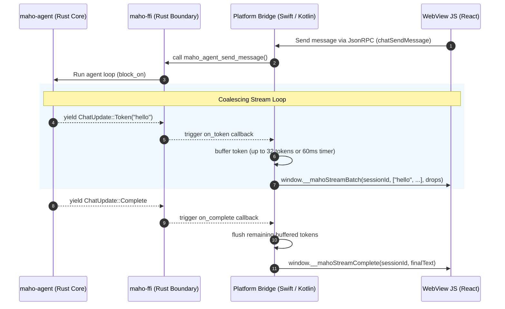

# Streaming Event Protocol Document

This document defines the streaming event protocol used for real-time tokens and events passing from the shared Rust core agent runtime (`maho-agent`) up to the user-facing JavaScript application (`web-ai` WebView) on desktop and mobile platforms.

## Sequence Diagram

The following diagram illustrates the token stream flow from a background thread in the Rust agent runtime, through the platform bridges, and finally into the web application.



---

## Event Schema Definitions

All events sent from the platform bridge to the WebView are serialized as JavaScript function calls on the global `window` object.

### 1. Token Batch (`window.__mahoStreamBatch`)
Coalesced array of generated text fragments. Sent to minimize WebView evaluate-script overhead.

* **Parameters**:
  * `sessionId` (string): The UUID identifying the active agent turn.
  * `tokens` (array of strings): The list of text tokens generated since the last flush.
  * `droppedCount` (integer, optional): Count of tokens discarded if the WebView main thread was blocked and the queue overflowed (max buffer: 256 tokens).

* **JSON Schema**:
```json
{
  "$schema": "http://json-schema.org/draft-07/schema#",
  "title": "StreamTokenBatch",
  "type": "object",
  "required": ["sessionId", "tokens"],
  "properties": {
    "sessionId": { "type": "string", "format": "uuid" },
    "tokens": {
      "type": "array",
      "items": { "type": "string" }
    },
    "droppedCount": { "type": "integer", "minimum": 0 }
  }
}
```

### 2. Stream Complete (`window.__mahoStreamComplete`)
Fired when the LLM finishes response generation.

* **Parameters**:
  * `sessionId` (string): The UUID identifying the active agent turn.
  * `finalText` (string): The fully accumulated markdown string generated during the entire session.

### 3. Stream Error (`window.__mahoStreamError`)
Fired if the network connection breaks, request times out, or agent panics.

* **Parameters**:
  * `sessionId` (string): The UUID identifying the active agent turn.
  * `error` (string): Error description (e.g. `"unauthorized"`, `"network timeout"`).

---

## Native Shell Protocol (v3 — agent runtime)

Native shells (Android Compose / iOS SwiftUI) do **NOT** use the `window.__mahoStream*` push protocol. They consume events via a **pull-based JSON envelope queue** exposed by `maho-agent` through `maho-ffi` / `maho-jni`.

### Flow

```
swiftide_agents::Agent.query()
  → builder.on_stream(...) callback fires per chunk
  → delta.message_chunk extracted
  → on_token user callback invoked (Rust)
  → enqueue_event(queue, "token", chunk) into thread-safe Vec<String>
  → JNI/Swift agentPollEvent() dequeues one event per call
  → SwiftUI/Compose consumer polls every 100ms on background thread
  → Main-thread dispatch parses JSON and updates @State / mutableStateOf
```

### Event envelope (JSON)

All native-shell events share a common envelope:

```json
{
  "type": "token" | "complete" | "error",
  "data": <type-dependent>
}
```

#### `token`
- `data`: string — a single text chunk from the LLM stream
- Emitted per `delta.message_chunk` in swiftide's `on_stream` callback
- Multiple per turn; the consumer concatenates for live display

#### `complete`
- `data`: `{ "full_text": string, "tool_calls_json": string }`
- Emitted once when `agent.query()` resolves successfully
- `full_text` is the assembled assistant response
- `tool_calls_json` is `"[]"` if no tool calls (placeholder for future agentic tool stream)

#### `error`
- `data`: string — error message
- Emitted on `AgentError` (ExecutionError, PermissionDenied, Cancelled, etc.)
- Polling consumer should transition UI to `failed` state

### Per-platform consumer pattern

**Android (Kotlin/Compose)** — `AgentScreen.kt`:
```kotlin
val pollJob = scope.launch(Dispatchers.IO) {
    while (activeLocalSessionId == sessionId && taskState == AgentTaskState.Working) {
        val eventJson = MahoBridge.agentPollEvent(sessionPtr)
        if (eventJson != null) {
            withContext(Dispatchers.Main) {
                val envelope = org.json.JSONObject(eventJson)
                when (envelope.optString("type")) {
                    "token" -> /* append to live log */
                    "complete" -> /* finalize state */
                    "error" -> /* surface error */
                }
            }
        }
        kotlinx.coroutines.delay(100)
    }
}
pollJob.invokeOnCompletion {
    // Single-owner free: zero state before agentFreeSession.
}
```

**iOS (Swift/SwiftUI)** — `AgentView.swift`:
```swift
pollTask = Task { @MainActor in
    defer {
        if activeSessionId == sessionId {
            sessionPtr = nil; activeSessionId = nil
        }
        bridge.agentFreeSession(ptr)
    }
    while !Task.isCancelled, activeSessionId == sessionId, taskState == .working {
        if let json = bridge.agentPollEvent(ptr) {
            processEvent(json)
        }
        try? await Task.sleep(for: .milliseconds(100))
    }
}
```

### Single-owner free invariant

The polling Job/Task is the **sole** owner of `agentFreeSession`. Cancel button and screen-disposal handlers call only `agentCancel` (FFI no-op on null), never `agentFreeSession`. State variables are zeroed BEFORE the FFI free call to prevent stale-pointer reads from concurrent Cancel button clicks. See `AgentScreen.kt:277-283` and `AgentView.swift` `pollTask.defer` block.

### Identity check uses UUID, not raw pointer

To eliminate ABA risk if the Rust allocator reuses a session pointer, identity comparisons use a Swift/Kotlin-side UUID (`sessionId`) rather than the raw `sessionPtr`. The pointer is still used for FFI calls; only the identity check uses UUID.

### Native vs WebView consumer comparison

| Aspect | Native (`agentPollEvent`) | WebView (`window.__mahoStream*`) |
|---|---|---|
| Direction | Pull (consumer polls) | Push (bridge calls JS) |
| Coalescing | None (single event per call) | Batched (up to 32 tokens or 60ms) |
| Backpressure | Naturally bounded by 100ms polling | Drop counter on overflow |
| Cleanup | Polling task lifecycle | `shutdownStreaming()` call |
| Identity | UUID + pointer | sessionId string |
| Use case | iOS / Android shells | Chromium overlay WebUI |

