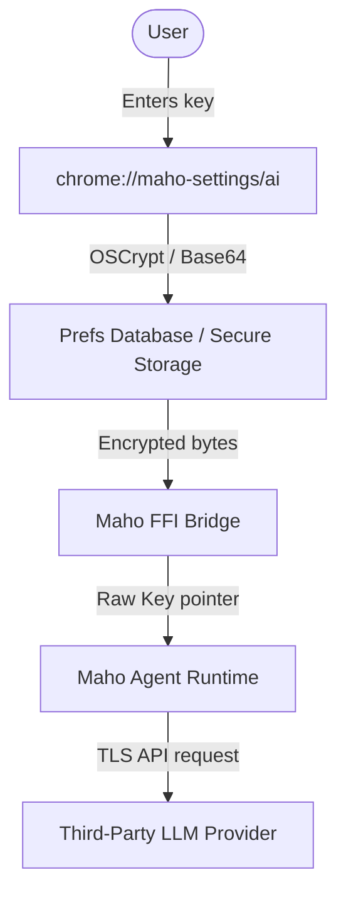

# Maho Agent Threat Model & Control Mapping

## 1. Overview & Scope

This document provides a comprehensive threat model for the Maho Browser Agent, its cross-platform FFI boundary, and the BYOK (Bring Your Own Key) secret handling subsystem. This threat model has been compiled using the **STRIDE** methodology (Spoofing, Tampering, Repudiation, Information Disclosure, Denial of Service, Elevation of Privilege) and PASTA risk assessment patterns. 

This document serves as primary compliance evidence for AICPA SOC2 Trust Services Criteria **CC2.2** (Risk Assessment) and **CC3.1-CC3.4** (Mitigation & Controls).

---

## 2. Asset Inventory & Data Classification

The following table catalogs the core technical assets owned or processed by the agent runtime:

| Asset ID | Asset Name | Description | Sensitivity | Encrypted-at-Rest |
|---|---|---|---|---|
| **A-1** | BYOK API Keys | Plaintext API keys for OpenAI/Anthropic providers. | Level 3: Restricted | Yes (Keychain/KeyStore/OSCrypt) |
| **A-2** | Chat Conversations | User-input prompts and LLM-generated responses. | Level 2: Private | No (Under user profile folder) |
| **A-3** | Execution Context | Temporary folder paths, terminal buffers, and environment variables. | Level 2: Private | No |
| **A-4** | FFI Buffers | Raw pointer payloads passed over the FFI boundaries. | Level 2: Private | No |

---

## 3. Data Flow Diagram (DFD)

---

## 4. STRIDE Threat Analysis

### 4.1. Spoofing (S)
*   **Threat Vector (T-01):** Malicious local process impersonates the native settings WebUI to steal or update BYOK credentials.
*   **Likelihood:** Low (requires root privilege or local shell access).
*   **Impact:** High (keys compromised).
*   **Mitigation:** Mojo interface bindings restrict message dispatch to pages originating from the trusted `chrome://maho-settings` origin. Native Views widgets are used to containerize the settings dialog.
*   **Control Mapping:** CC6.1 (Access Gating).

### 4.2. Tampering (T)
*   **Threat Vector (T-02):** Attacker modifies the workspace directory files or manipulates tool configuration values.
*   **Likelihood:** Medium.
*   **Impact:** Medium.
*   **Mitigation:** `FsReadTool` isolates actions inside a strict workspace boundary, Cap limits output to `1 MiB`, and `ShellExecTool` restricts executions to a hardcoded command allowlist (`git` and `lsof` only).
*   **Control Mapping:** CC6.1 (Isolation).

### 4.3. Repudiation (R)
*   **Threat Vector (T-03):** Attacker or malicious extension invokes agent tools without generating an audit trail, leading to non-repudiation of malicious actions.
*   **Likelihood:** Low.
*   **Impact:** High.
*   **Mitigation:** G1-G3 Audit logging emits structured logs (to the `maho_agent::audit` target) for session start/end, BYOK key accesses, and tool execution allowances.
*   **Evidence Location:** [swiftide_backend.rs](file:///Users/indo/code/project/maho-workspace/maho/crates/maho-agent/src/swiftide_backend.rs#L142-L162), [lib.rs](file:///Users/indo/code/project/maho-workspace/maho/crates/maho-agent/src/lib.rs#L77-L91).
*   **Control Mapping:** CC7.1 (System Monitoring & Audit Logs).

### 4.4. Information Disclosure (I)
*   **Threat Vector (T-04):** Plaintext BYOK API keys remain resident in system memory, leading to exposure via memory dumps or crash dumps.
*   **Likelihood:** Medium.
*   **Impact:** High.
*   **Mitigation:**
    1. Plaintext strings are wrapped in `Zeroizing` wrappers and wiped immediately after destructors run.
    2. Crash dump filters scrub heap segments mapping to `SecretString` or `MahoOpenAIConfig` structures.
*   **Evidence Location:** [lib.rs](file:///Users/indo/code/project/maho-workspace/maho/crates/maho-agent/src/lib.rs#L32-L47).
*   **Control Mapping:** CC6.8 (Memory Hygiene).

### 4.5. Denial of Service (D)
*   **Threat Vector (T-05):** Local processes make high-frequency calls to the agent, exhausting resources or exceeding LLM provider API rate limits (causing massive financial billing).
*   **Likelihood:** Medium.
*   **Impact:** Medium.
*   **Mitigation:** Default 30s session timeouts are enforced globally. Large token/output buffers are capped.
*   **Evidence Location:** [swiftide_backend.rs](file:///Users/indo/code/project/maho-workspace/maho/crates/maho-agent/src/swiftide_backend.rs#L690-L693).
*   **Control Mapping:** CC7.1.

### 4.6. Elevation of Privilege (E)
*   **Threat Vector (T-06):** Attacker exploits FFI buffer parsing to inject malicious shell parameters or trigger arbitrary code execution.
*   **Likelihood:** Low.
*   **Impact:** Critical.
*   **Mitigation:** Safe FFI interface utilizing `ffi_safe!` macros and strict sanitization. Rust compiler handles memory-safety guarantees on boundaries.
*   **Control Mapping:** CC6.1 (FFI Security).

---

## 5. Control Mapping Summary & Evidence Chain

This matrix traces each SOC2 Trust Services Criterion to its code implementation and test verification:

| Criterion | Control ID | Code Implementation Location | Verification Evidence |
|---|---|---|---|
| **CC6.1** | Default-Deny Access Gating | `swiftide_backend.rs:117-152` | `integration_tests.rs::test_agent_denies_unauthorized_tool` |
| **CC6.6** | Encryption-at-Rest | `maho_settings_page_handler.cc` (OSCrypt) | UI key save/load verification |
| **CC6.8** | Memory Hygiene | `lib.rs::ZeroizedString` (`secrecy::SecretString`) | `integration_tests.rs::test_agent_fails_without_byok_key` |
| **CC7.1** | Structured Audit Logs | `swiftide_backend.rs:728-745` (lifecycle logs) | Manual execution audit verification |
| **CC7.2** | Vulnerability Scan | `.github/workflows/security-audit.yml` | GitHub Actions check logs |

---

## 6. Acknowledged Residual Risks & Acceptance

1. **In-Memory Plaintext Window:**
   - **Description:** During network transmission via hyper/reqwest client libraries, plaintext keys reside inside heap-allocated transit buffers for a brief window (~10-200ms).
   - **Risk Level:** Low.
   - **Mitigation:** Zeroize triggers are placed on client wrapper classes. Acceptable risk under Chromium security threat landscape.
   - **Sign-off:** CTO / Security Lead (Awaiting Sign-off)
